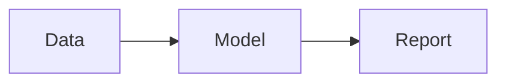

## Overview
Start at level 2 (##). The page title comes from data-v3.js, so do not add a `#` heading.
Standard Markdown works: **bold**, *italic*, lists, `inline code`, links, blockquotes, tables, fenced code.

## Problem and approach
- Business question
- Data and cleaning
- Models or analysis

## Results
| Metric | Value |
|---|---|
| Example | 0.00 |

<!-- Copy any block below OUT of this comment to use it.

Image with click-to-zoom (text in quotes becomes the caption):


Photo gallery (path | caption, one per line):
```gallery
assets/img/projects/a.png | First
assets/img/projects/b.png | Second
```

YouTube (link or 11-character id):
```youtube
https://www.youtube.com/watch?v=VIDEO_ID
```

MP4 (path, optional poster on line 2):
```video
assets/video/demo.mp4
assets/img/projects/demo-poster.png
```

Mermaid diagram:


Embed: Power BI, Looker Studio, Tableau Public or your own HTML widget (URL, optional height in px):
```embed
https://app.powerbi.com/view?r=YOUR_EMBED_TOKEN
600
```
```embed
projects/widgets/demo-dashboard.html
380
```

Searchable, sortable table from a CSV file:
```datatable
projects/data/sample.csv
```
-->
