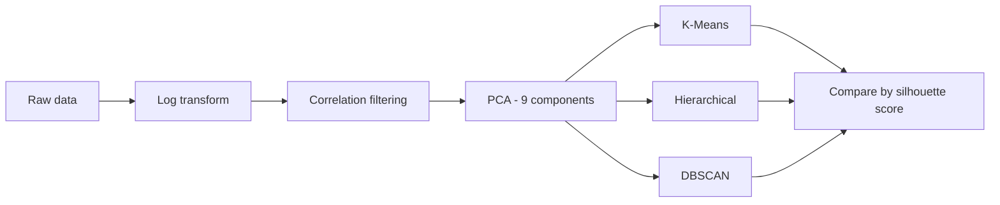

## Overview

This project groups **8,950 credit card customers** by how they spend and repay, so a bank can target marketing and manage credit risk differently for each group.

> Key finding: K-Means with k=2 splits customers into 60% purchase-active customers and 40% cash-advance, high-balance carriers.

## Workflow



## Method

1. Log-transformed skewed spending features.
2. Dropped highly correlated features.
3. Reduced dimensions with PCA, keeping 95% of the variance (9 components).
4. Compared K-Means, Hierarchical and DBSCAN using silhouette score.

## Customer groups

| Segment | Share | Behavior |
|---|---|---|
| Purchase-active | 60% | Spend mostly through purchases |
| Cash-advance carriers | 40% | Use cash advances and carry high balances |

## Code

```python
from sklearn.decomposition import PCA
from sklearn.cluster import KMeans

X_pca = PCA(n_components=0.95).fit_transform(X_scaled)
labels = KMeans(n_clusters=2, random_state=42, n_init=10).fit_predict(X_pca)
```

<!-- Add media by moving these blocks out of the comment once the files exist:


```gallery
assets/img/projects/seg-1.png | Elbow curve
assets/img/projects/seg-2.png | Silhouette scores
```
-->

## Repository

Full notebook and code are in the GitHub repository linked at the top of this page.
